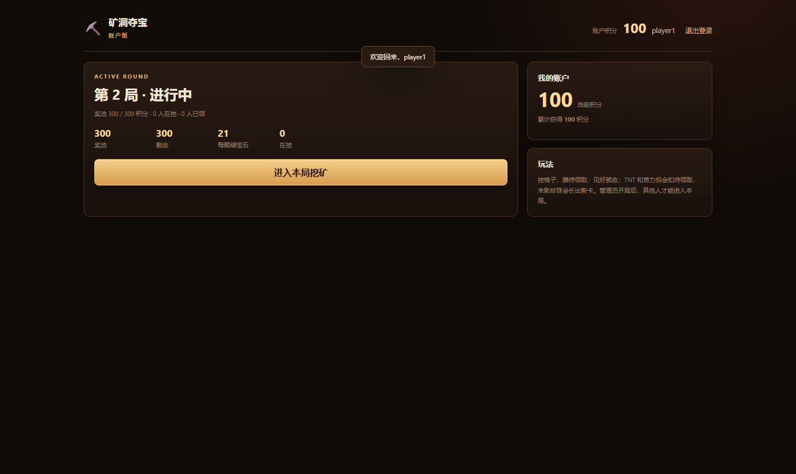

# 矿洞夺宝 · 账户版

一个独立可部署的多人挖矿游戏，不需要 hb.lafi.sh、Cloudflare Worker 或 Vercel：



- 注册 / 登录账户，密码经过 scrypt 哈希保存。
- **只有管理员可以开启一局**；普通用户只能进入管理员已经开启的那一局。
- 多人在同一张矿洞地图上挖宝，规则沿用「见好就收」：奖励先进入待领取，领取后才结算。
- 领取的积分会即时加到账户余额；每局结束、奖池分完或管理员结束时，未领取的奖励自动结算入账。
- 管理员可以查看用户账户、当前局状态和历史局记录。

## 快速开始

需要 Node.js 18+，零依赖。

```bash
cd mining-game
npm start
```

打开 <http://127.0.0.1:4173>。

**第一个注册的账号自动成为管理员**。也可以在启动前设置：

```bash
ADMIN_USERNAME=admin ADMIN_PASSWORD=你的密码 npm start
```

PowerShell：

```powershell
$env:ADMIN_USERNAME='admin'; $env:ADMIN_PASSWORD='你的密码'; npm start
```

## 使用流程

1. 管理员注册/登录，进入大厅。
2. 管理员点「开启新一局」，选奖池、每人次数、难度等参数。
3. 其他用户注册/登录，在大厅看到进行中的一局，点「进入本局挖矿」。
4. 玩家挖格子、使用道具、点「见好就收」；领取的积分进入账户。
5. 管理员可以在大厅点「结束当前一局」；结束时所有未领取的奖励会自动结算到各自账户。

## 账户与数据

- 用户、密码哈希、积分、累计获得、每局记录保存在 `data/users.json` 和 `data/rounds.json`。
- 当前进行中的游戏状态保存在进程内存；重启服务会结束当前局，但账户积分和局记录不会丢。
- 默认 `bots: 0`，纯真人局；管理员创建时可以在配置面板加机器人。
- 页面是响应式的，桌面和手机都能用。

## 目录

```
mining-game/
├─ server.js          # 账户、登录、管理员开局、局管理、静态文件
├─ game/
│  ├─ content.js      # 物品、卡种、难度
│  └─ engine.js       # 共享矿洞/挖掘/道具/领取规则
├─ public/
│  ├─ index.html      # 登录、注册、大厅、游戏
│  ├─ styles.css
│  └─ app.js
└─ test/
   └─ engine.test.js
```

## 部署到 Abasthan

Abasthan 直接选 **Web Service → Node.js 22**：

- Build Command：`npm install`
- Start Command：`npm start`
- Port：使用平台注入的 `PORT`（服务已经监听 `0.0.0.0`）
- 环境变量：`ADMIN_USERNAME`、`ADMIN_PASSWORD` 可选；`DATA_DIR` 可选
- 如果使用持久盘，把 `DATA_DIR` 指向持久目录；否则重新部署后用户账户会保留（`data` 需要一起持久化，或换数据库）

## 当前限制

- 单进程、单房间；同一时间只能有一局进行中（符合“管理员开启一局，其他人进入”的规则）。
- 当前游戏状态在内存里，服务重启会结束进行中的局；生产环境建议把 `server.js` 的 `JsonStorage` 换成 Postgres/Redis，并把游戏状态持久化。
- 没有邮箱验证、找回密码、第三方登录；注册即可玩。
- 美术使用 emoji 近似，不含 Minecraft 原版素材。
