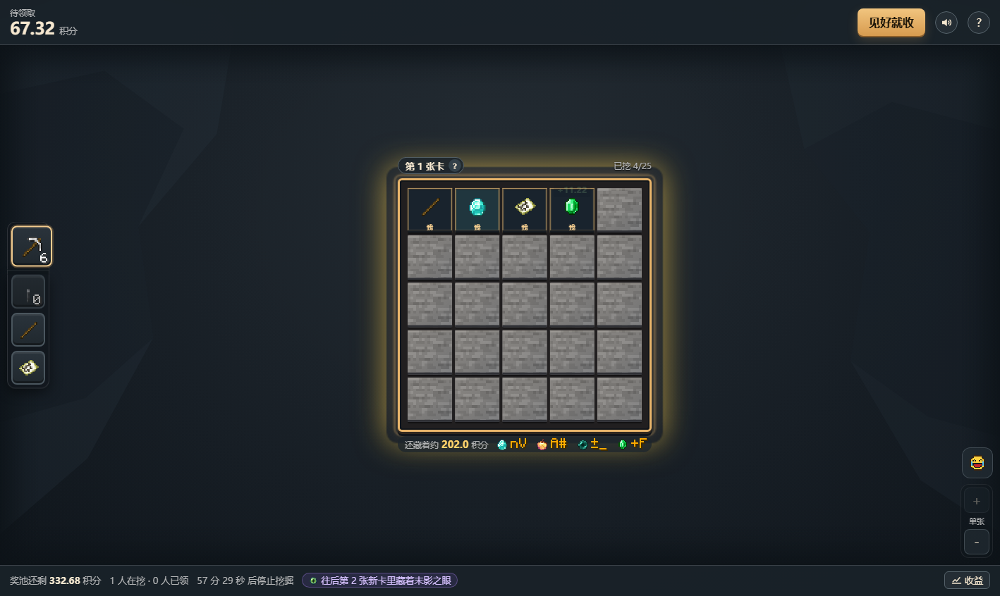

# 矿洞夺宝 · 账户版

原版「矿洞夺宝」的**完整 1:1 游戏界面**（原版 React + Canvas 页面），外面套一层账户系统：

- 注册 / 登录，密码 scrypt 加盐哈希，HttpOnly Cookie 会话
- **只有管理员能开局**，普通用户只能进入管理员已经开启的那一局
- 多人共享同一张矿洞地图，规则就是原版 `MineRoom`（`vendor/worker/room.mjs`，与线上游戏站同一份）
- 「见好就收」领取的积分**直接记到账户余额**，不再经过 hb.lafi.sh
- 管理员可以查看**全部注册用户**、角色和积分



## 快速开始

需要 Node.js 20+。

```bash
cd mining-game
npm start
```

打开 <http://127.0.0.1:4173>。**第一个注册的账号自动成为管理员。**

也可以预设管理员：

```powershell
$env:ADMIN_USERNAME='admin'; $env:ADMIN_PASSWORD='你的密码'; npm start
```

## 使用流程

1. 管理员注册/登录 → 大厅
2. 管理员点「开启新一局」，填奖池、每人次数、难度、时长
3. 其他用户注册/登录 → 大厅看到「第 N 局 · 进行中」→ 点「进入本局挖矿」
4. 进入原版游戏界面：拖动地图、点格子挖宝、用道具、点「见好就收」
5. 领取后积分立刻进账户；管理员点「结束当前一局」时，未领取的奖励自动结算入账

## 目录

```
mining-game/
├─ server.js              # 账户、大厅、原版页面接口（/v3/api）、hb 桥（/api/hb）
├─ server/
│  ├─ accounts.js         # 注册、登录、会话、积分
│  ├─ rounds.js           # 一局 = 一个 MineRoom + JSON 存储 + 领取凭证校验
│  └─ ws.js               # 极简 WebSocket 服务端（实时推送）
├─ vendor/                # 原版规则与房间（game/shared、game/worker）
├─ web/                   # 原版 v3 前端源码（React + Canvas）
└─ public/
   ├─ index.html          # 登录 / 注册 / 大厅
   ├─ app.js
   ├─ styles.css
   └─ game/               # 构建好的原版游戏页面
```

## 构建前端

`public/game/` 已经包含构建产物，改 `web/` 后重新构建：

```bash
npm run build:web
```

Windows 上如果 `vite build` 报 `esbuild ... Access is denied`，是因为项目路径含空格。可以把项目复制到 `C:\mg` 之类的短路径再构建，或直接把构建产物放进 `public/game/`。

## 部署到 Abasthan

Web Service → Node.js 22：

| 配置 | 值 |
| --- | --- |
| Repository | 你的仓库 |
| Root Directory | `mining-game` |
| Build Command | `npm install`（前端产物已提交，不需要构建） |
| Start Command | `npm start` |
| Port | 使用平台注入的 `PORT`（服务监听 `0.0.0.0`） |

环境变量（可选）：

```dotenv
ADMIN_USERNAME=admin
ADMIN_PASSWORD=你的管理员密码
DATA_DIR=/home/abasthan/app/data
TICKET_KEY=一串随机长字符串
```

- `DATA_DIR` 要放持久盘，否则重新部署会丢账户和积分。
- `TICKET_KEY` 用来签游戏票据和领取凭证；不设则每次重启随机生成（重启后旧的领取凭证失效，但积分已经入账，不影响）。
- 服务重启时，进行中的那一局会标记为结束；账户积分和局记录保留。

## 与线上原版的区别

- 身份来自本服务的账户，不再需要 LINUX DO 登录或 hb.lafi.sh 红包页。
- 领取不走判定器：本服务自己校验 `MineRoom` 签的凭证，校验通过直接入账。
- 指针、表情（presence）暂未实现，只保持连接。
- 单位是「积分」，1 积分 = 100 个规则最小单位，页面上按 `0.01` 显示两位小数。

## 素材

`public/game/assets/minecraft/` 下的贴图和模型版权属于 Mojang，仅用于本地演示；如果要公开发布，请自行确认授权，或删掉这些文件改用占位图。
